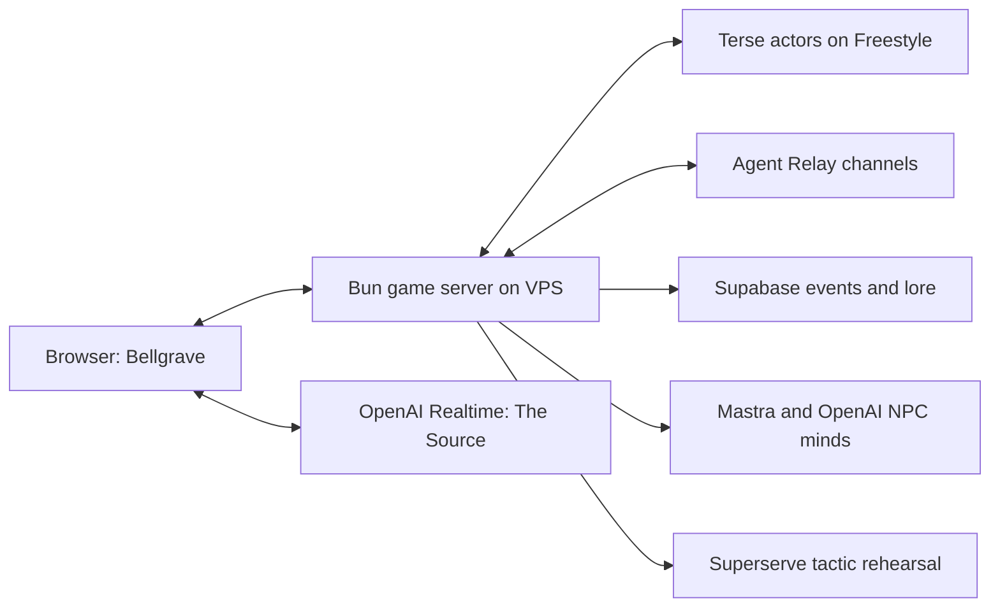

# Issekaied — The Dead Remember

A first-person Halloween adventure built around **stateful characters** and **agent-to-agent communication**: the ghosts you banish remember your name, share warnings, and come back with a grudge.

<p align="center"></p>

*Project key art. Gameplay uses a 3D courtyard, illustrated ghost impostors and live interface elements.*

[Play the demo](https://issekaied.ayushojha.com) · [Project pitch](docs/PROJECT-PITCH.md) · [Verification notes](docs/DEMO.md) · [Asset credits](docs/MAP-ASSETS.md)

## The hunt

Your old world ended. A ten-second narrated prologue brings you into Bellgrave: a hand-built Halloween realm of pumpkin graves, ruined chapel arches, lantern paths and a guarded eastern altar. Fifty enemies inhabit the expanded map. Recover three sigils from Morrow, Nix and Vesper, then confront Raksha. The echo portal changes the encounter inside this same world.

The hunter draws strength from Ganesha, Hanuman, Shiva and Vishnu according to the encounter. There is no deity-selection screen. Ghosts patrol their own areas, warn one another and adapt when a remembered hunter returns.

| Control | Action |
| --- | --- |
| WASD / Shift | Move / sprint |
| Left mouse / right mouse | Primary attack / protective ward |
| Q | Invoke the appropriate divine incantation |
| R | Recovery mantra |
| E | Shrine, portal or explicit return after defeat |
| V / The Source panel | Push-to-talk, or type a question |
| Escape | Pause and release the mouse |

Settings control music, voice, effects, look sensitivity and reduced motion. Visible weapon swings and ward animations accompany mouse attacks. Incantations last under two seconds, use distinct portraits, mandalas, wind, frost and chakra effects, and cost 25 vitality. Nearby enemies speak sparingly; the Source answers when you ask. Movement requires held keys and stops when input is released or lost.

The on-screen hunter leaderboard records banishments, deaths, arrivals and play time from server-authored events in Supabase. Ghost memory and player history continue across hunts.

## Stateful characters: a world that remembers

A banishment records the hunter, power and event ID. The returning ghost retrieves that history, changes tactics and can speak about the encounter. Shiva, Vishnu and The Source retain shared context across games; The Source maintains player arrivals, deaths and banishments and answers questions using the current objective and world state.

The Source uses OpenAI Realtime for two-way voice and text. Microphone access starts only through a player action; the game does not persist raw microphone audio. Recorded gameplay facts, rather than chat claims, update durable counters.

## Agent-to-agent communication: a world that reacts

After a banishment, Agent Relay carries a grounded warning through the enemy hivemind. Recipients can change tactics when the message is delivered. The pantheon shares invocation outcomes, while the Source distributes canonical world facts. Persistent state gives each character history; communication lets those characters influence one another.

## Join the same world

Open [issekaied.ayushojha.com](https://issekaied.ayushojha.com), enter a hunter name and join Bellgrave. Participants share the live room and see one another. A browser guest key keeps identity stable between visits; names alone are not identity. The server enforces a configured capacity of 50 hunters, but 50 simultaneous real browsers have not been load-tested. The hunter ledger records accepted joins and gameplay events in Supabase.

## How the sponsors are used

| Technology | Responsibility in Issekaied |
| --- | --- |
| **Terse Durable Actors** | Persistent `Ghost`, `Deity` and `Source` actors hold grudges, cited encounter history, global divine context and player statistics. Actor methods remain short and do not wait on external services. |
| **Agent Relay** | Real pantheon and enemy-hivemind channels carry warnings and shared context between participants. A recipient can change tactics after another ghost's warning. The deployment can use the official self-hosted Relaycast engine. |
| **OpenAI** | NPC decisions and individual voices; Realtime voice/text conversation with The Source. Models are selected through environment configuration. |
| **Mastra** | Event-triggered NPC agent orchestration with structured dialogue, validated strategy choices and supporting event IDs. |
| **Supabase** | Canonical gameplay events, guest-player records and searchable lore. Unique event IDs prevent duplicate history; RLS protects the backend-only tables. |
| **Freestyle** | Hosts the actual Terse actor runtime on an isolated persistent VM, separate from the VPS game server. |
| **Superserve** | Executes trusted, bounded tactic/encounter-scoring jobs in disposable sandboxes. Results are validated before affecting a returning ghost or echo encounter. |

### Track technology in the running game

**Terse is a real remote runtime here.** [`actor/src/`](actor/src/) defines the durable ghost, deity and Source actors. [`server/src/integrations/memory.ts`](server/src/integrations/memory.ts) calls them through `terse-sdk` actor stubs. The actor service runs on a Freestyle VM; the main game API runs on the VPS. Ghost banishments and grudges, shared Shiva/Vishnu context and the Source ledger survive independently of a room's lifetime. This demo self-hosts Terse's local/dev runtime, rather than claiming managed Terse Cloud or replicated production infrastructure.

**Agent Relay is in the gameplay path.** [`server/src/integrations/relay.ts`](server/src/integrations/relay.ts) uses `@agent-relay/sdk` with the private self-hosted Relaycast engine: `hivemind` delivers enemy warnings that recipients use to change tactics; `pantheon` shares invocation outcomes between divine agents. The Source also relays canonical world facts. This is the SDK integration, separate from installing the coding-session CLI. The official [Agent Relay framework guide](https://agentrelay.net/docs/communicate) and [Relaycast self-hosting guide](https://github.com/AgentWorkforce/relaycast#self-hosting) describe these supported integration paths.

The public [`/health`](https://issekaied.ayushojha.com/health) endpoint exposes provider modes, reachability and sent/received counters. `terse` and `relay` identify actual provider paths; fallback modes are explicitly named. Counters are per process and reset on deployment. They are operational evidence, not sponsor billing receipts.

Movement and combat never wait for model, database, actor-network or sandbox calls. Provider failures have explicit modes; a local fallback is never presented as a successful hosted integration.



## Run locally

Use Bun and configure the server-side values in `.env.example`. In PowerShell, from the repository root:

```powershell
Copy-Item .env.example .env
Set-Location server
bun install
bun run dev
```

In another terminal, from the repository root:

```powershell
$env:ISSEKAIED_BACKEND_URL = "http://127.0.0.1:8791"
Set-Location client
bun install
bun run dev
```

Set `PORT=8791` and `HOST=127.0.0.1` for that local setup. Production containers bind to `0.0.0.0`; the public HTTPS endpoint proxies HTTP and WebSockets to the same backend.

Required runtime configuration includes `OPENAI_API_KEY`, `OPENAI_MODEL`, `OPENAI_TTS_MODEL`, `OPENAI_REALTIME_MODEL`, `OPENAI_REALTIME_VOICE`, `SUPABASE_URL`, the Supabase backend secret, `TERSE_ACTOR_URL`, `TERSE_API_KEY`, `RELAY_BASE_URL` and `RELAY_WORKSPACE_KEY`. Tactic rehearsal also uses `SUPERSERVE_API_KEY`, `SUPERSERVE_TEMPLATE` and `SUPERSERVE_REHEARSAL=1`.

Keep management credentials and provider keys out of browser code and `VITE_` variables. The Source endpoint returns only a short-lived Realtime credential. Actor setup is documented in [actor/README.md](actor/README.md); the additive database setup is under `server/supabase/`.

## Verification and limits

The backend passes 31 focused tests. Network checks cover 50 unique enemies, authoritative health-cost powers, stale-input expiry and leaderboard persistence across a restart; the integrated client build passes. OpenAI Realtime connected in the public browser and answered grounded objective questions with streamed audio. Hosted Terse state survived service restart; actual Relay delivery and database RLS/idempotency/search were checked independently. See [the demo notes](docs/DEMO.md) for exact evidence and limits.

Both frontend and backend are live at the demo URL. The VPS deployment script builds immutable releases from `main`, checks the Source routes before activation and preserves the previous release for rollback. See [deployment instructions](deploy/vps/README.md).

A separate 50-client, 15-second synthetic smoke is not a claim of 50 real browser players or production readiness. Guest identity belongs to the browser key, not the display name. The hosted actor service uses Terse's local/dev runtime on Freestyle with demo lifecycle limits. Source deduplication and retained player records are bounded at 5,000; canonical event history remains in Supabase.

Active room positions and quest progress reset when the game API restarts; durable ghost history and recorded events remain in Terse and Supabase. Text questions, controlled spoken input and streamed Source replies passed public acceptance. A physical microphone still needs a human check.

Music credits and optimized-file provenance are in [audio credits](assets/audio/optimized/CREDITS.md). Voices and traditional recitations are synthesized with artificial intelligence; pronunciation and Vedic intonation are not human-certified. [Hanuman](assets/audio/hanuman/PROVENANCE.md), [Shiva](assets/audio/shiva/PROVENANCE.md) and [Maha Mrityunjaya](assets/audio/mantra/PROVENANCE.md) source records are included.

## Repository and license

`client/` contains Babylon.js, audio and the interface; `server/` contains the authoritative game and provider adapters; `actor/` contains durable state; `shared/` defines the map/protocol; `assets/` and `docs/` contain art, music and provenance.

No project-wide code license is currently checked in. Third-party assets retain their included CC0 or CC-BY-4.0 terms. Preserve the notices and attribution when redistributing them.
