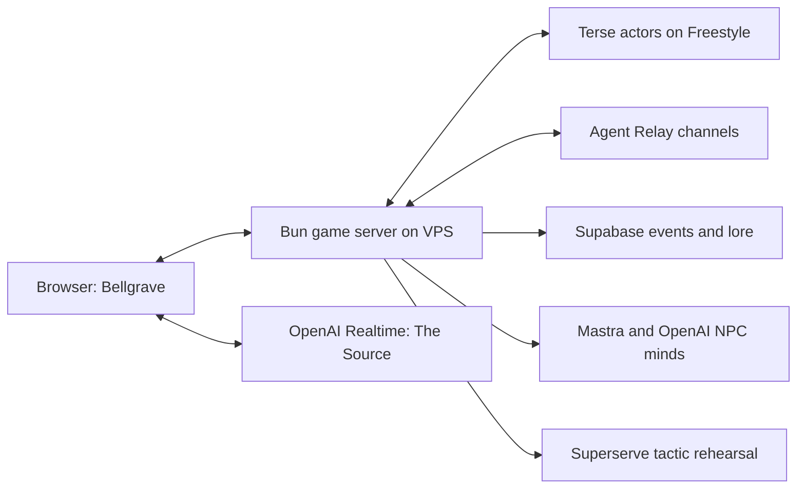

# Issekaied — The Dead Remember

A first-person Halloween adventure where the ghosts you banish remember your name, learn from the encounter, and come back with a grudge.

<p align="center"></p>

*Project key art. Gameplay uses a 3D courtyard, illustrated ghost impostors and live interface elements.*

[Play the demo](https://issekaied.ayushojha.com) · [Project pitch](docs/PROJECT-PITCH.md) · [Verification notes](docs/DEMO.md) · [Asset credits](docs/MAP-ASSETS.md)

## The hunt

You died in your old world and awoke in Bellgrave. The Source remembers your arrival. Follow the lantern-lit path from the safe gate, recover three sigils from Morrow, Nix and Vesper, and confront Raksha at the eastern altar. The echo portal changes the encounter inside this same courtyard.

The hunter draws strength from Ganesha, Hanuman, Shiva and Vishnu according to the encounter. There is no deity-selection screen. Ghosts patrol their own areas, warn one another and adapt when a remembered hunter returns.

| Control | Action |
| --- | --- |
| WASD / Shift | Move / sprint |
| Left mouse / right mouse | Primary attack / protective ward |
| Q | Invoke the appropriate divine incantation |
| R | Recovery mantra |
| E | Shrine, portal or explicit return after defeat |
| V / The Source panel | Push-to-talk, or type a question |
| Escape | Pause and release the mouse |

Settings control music, voice, effects, look sensitivity and reduced motion. Incantations use distinct portraits, mandalas, wind, frost and chakra effects with camera-safe feedback.

## A world that remembers

A banishment records the hunter, power and event ID. The returning ghost retrieves that history, changes tactics and can speak about the encounter. Shiva, Vishnu and The Source retain shared context across games; The Source maintains player arrivals, deaths and banishments and answers questions using the current objective and world state.

The Source uses OpenAI Realtime for two-way voice and text. Microphone access starts only through a player action; the game does not persist raw microphone audio. Recorded gameplay facts, rather than chat claims, update durable counters.

## How the sponsors are used

| Technology | Responsibility in Issekaied |
| --- | --- |
| **Terse Durable Actors** | Persistent `Ghost`, `Deity` and `Source` actors hold grudges, cited encounter history, global divine context and player statistics. Actor methods remain short and do not wait on external services. |
| **Agent Relay** | Real pantheon and enemy-hivemind channels carry warnings and shared context between participants. A recipient can change tactics after another ghost's warning. The deployment can use the official self-hosted Relaycast engine. |
| **OpenAI** | NPC decisions and individual voices; Realtime voice/text conversation with The Source. Models are selected through environment configuration. |
| **Mastra** | Event-triggered NPC agent orchestration with structured dialogue, validated strategy choices and supporting event IDs. |
| **Supabase** | Canonical gameplay events, guest-player records and searchable lore. Unique event IDs prevent duplicate history; RLS protects the backend-only tables. |
| **Freestyle** | Hosts the actual Terse actor runtime on an isolated persistent VM, separate from the VPS game server. |
| **Superserve** | Executes trusted, bounded tactic/encounter-scoring jobs in disposable sandboxes. Results are validated before affecting a returning ghost or echo encounter. |

Movement and combat never wait for model, database, actor-network or sandbox calls. Provider failures have explicit modes; a local fallback is never presented as a successful hosted integration.



## Run locally

Use Bun and configure the server-side values in `.env.example`. In PowerShell, from the repository root:

```powershell
Copy-Item .env.example .env
Set-Location server
bun install
bun run dev
```

In another terminal, from the repository root:

```powershell
$env:ISSEKAIED_BACKEND_URL = "http://127.0.0.1:8791"
Set-Location client
bun install
bun run dev
```

Set `PORT=8791` and `HOST=127.0.0.1` for that local setup. Production containers bind to `0.0.0.0`; the public HTTPS endpoint proxies HTTP and WebSockets to the same backend.

Required runtime configuration includes `OPENAI_API_KEY`, `OPENAI_MODEL`, `OPENAI_TTS_MODEL`, `OPENAI_REALTIME_MODEL`, `OPENAI_REALTIME_VOICE`, `SUPABASE_URL`, the Supabase backend secret, `TERSE_ACTOR_URL`, `TERSE_API_KEY`, `RELAY_BASE_URL` and `RELAY_WORKSPACE_KEY`. Tactic rehearsal also uses `SUPERSERVE_API_KEY`, `SUPERSERVE_TEMPLATE` and `SUPERSERVE_REHEARSAL=1`.

Keep management credentials and provider keys out of browser code and `VITE_` variables. The Source endpoint returns only a short-lived Realtime credential. Actor setup is documented in [actor/README.md](actor/README.md); the additive database setup is under `server/supabase/`.

## Verification and limits

The backend has passed 28 focused tests and a 36-check, two-client full-quest network run. Browser checks cover safe idle spawning, movement, discrete attacks, wards, shrine interaction, explicit respawn and teardown. OpenAI Realtime connected in the browser and answered grounded objective questions with streamed audio. Hosted Terse state survived service restart; actual Relay delivery and database RLS/idempotency/search were checked independently. See [the demo notes](docs/DEMO.md) for the distinction between isolated and live checks.

Both frontend and backend are live at the demo URL. The VPS deployment script builds immutable releases from `main`, checks the Source routes before activation and preserves the previous release for rollback. See [deployment instructions](deploy/vps/README.md).

A separate 50-client, 15-second synthetic smoke is not a claim of 50 real browser players or production readiness. Guest identity belongs to the browser key, not the display name. The hosted actor service uses Terse's local/dev runtime on Freestyle with demo lifecycle limits. Source deduplication and retained player records are bounded at 5,000; canonical event history remains in Supabase.

Music credits and optimized-file provenance are in [audio credits](assets/audio/optimized/CREDITS.md). Voices and traditional recitations are synthesized with artificial intelligence; pronunciation and Vedic intonation are not human-certified. [Hanuman](assets/audio/hanuman/PROVENANCE.md), [Shiva](assets/audio/shiva/PROVENANCE.md) and [Maha Mrityunjaya](assets/audio/mantra/PROVENANCE.md) source records are included.

## Repository and license

`client/` contains Babylon.js, audio and the interface; `server/` contains the authoritative game and provider adapters; `actor/` contains durable state; `shared/` defines the map/protocol; `assets/` and `docs/` contain art, music and provenance.

No project-wide code license is currently checked in. Third-party assets retain their included CC0 or CC-BY-4.0 terms. Preserve the notices and attribution when redistributing them.
