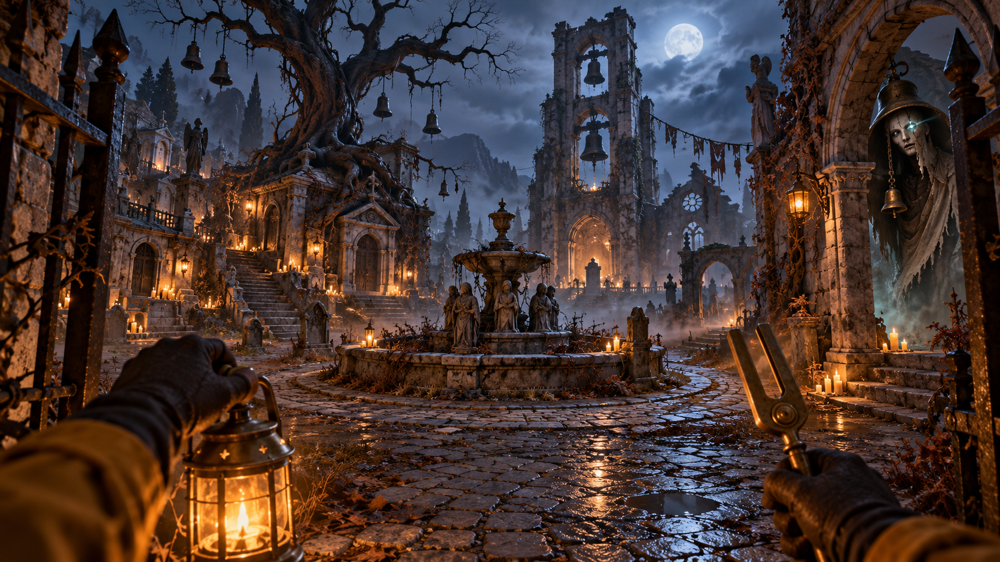

# Issekaied

A first-person ghost-hunting hackathon prototype: defeated ghosts remember the hunter, return with adapted tactics, and warn other ghosts.

*Visual direction for Bellgrave; concept art rather than a gameplay screenshot.*

The player draws power automatically from Ganesha, Hanuman, Shiva or Vishnu according to the targeted enemy's encounter level. The deities provide aid; enemies include ghosts, ghouls, goblins, orcs, beasts and rakshasas.

## Current checkpoint

- Character, ghost, map and divine-invocation artwork is available.
- Licensed 3D environments and modular cemetery assets are downloaded, with source and attribution records.
- Shared world data and the initial multiplayer message contract are defined in `shared/`.
- Playable client and server implementation is in progress. Approximately 50 simultaneous players is a target pending measurement.

## Project map

| Path | Purpose |
| --- | --- |
| `client/` | Babylon.js and TypeScript browser client, under development |
| `shared/` | World layout, message types and automatic invocation mapping |
| `assets/generated/` | Transparent deity portraits and enemy concept artwork |
| `assets/environments/` | Assembled village and haunted-house GLB scenes |
| `assets/environment-kits/` | Kenney and KayKit modular models and licenses |
| `docs/` | Concept art, generation prompts, asset catalog and preview captures |

## Configuration

Copy `.env.example` to `.env` and configure server-side provider access when needed. `OPENAI_MODEL` controls the model without source-code changes. Keep credentials out of client code and `VITE_` variables. Local `.env` files, dependencies and orchestration logs are ignored by Git.

The intended stack is Babylon.js, TypeScript, Vite and Bun, with Terse Durable Actors for persistent ghost state, Mastra for event-triggered ghost intelligence, Agent Relay for warnings, and Freestyle for hosting. Integration availability will be reported from actual runtime checks as implementation proceeds.

## Art and asset records

- [Map assets, licenses, browser preview links and verification limits](docs/MAP-ASSETS.md)
- [Character and ghost concept prompts](docs/concept-art/PROMPTS.md)
- [Map concept prompts](docs/concept-art/MAP-PROMPTS.md)
- [Divine invocation and enemy-art prompts](assets/generated/PROMPTS.md)

## License

No project-wide code license is currently checked in. Third-party assets retain their original CC0 or CC-BY-4.0 licenses; preserve the included notices and attribution records when redistributing them.
First-person ghost-hunting hackathon prototype with persistent ghost memories and automatic divine invocations.
